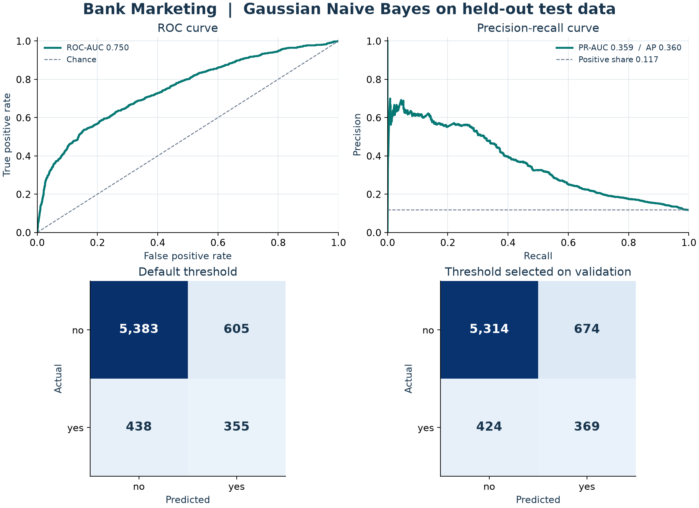
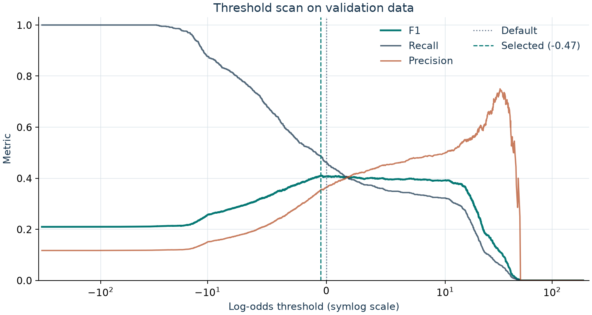
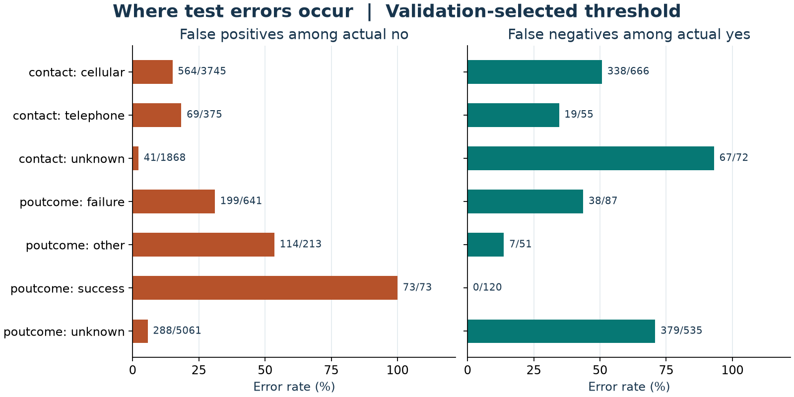

# Bank Marketing：A 同学实验结果

输入：`bank+marketing.zip`；共有 45,211 条记录。正类为认购定期存款（`y=yes`）。随机种子 42。使用 50 个编码后的特征，`duration`未用于训练。

| 划分 | 样本数 | no | yes | 正类占比 |
|---|---:|---:|---:|---:|
| train | 31,648 | 27,946 | 3,702 | 11.70% |
| validation | 6,782 | 5,988 | 794 | 11.71% |
| test | 6,781 | 5,988 | 793 | 11.69% |

## 测试集表现

| 决策规则 | 准确率 | 精确率 | 召回率 | F1 |
|---|---:|---:|---:|---:|
| 默认阈值 | 0.8462 | 0.3698 | 0.4477 | 0.4050 |
| 验证集所选阈值 | 0.8381 | 0.3538 | 0.4653 | 0.4020 |

ROC-AUC **0.7497**，梯形 PR-AUC **0.3592**，AP **0.3604**。PR 曲线的随机参考线为测试集正类占比 **11.69%**。始终预测 no 的准确率为 88.31%，正类召回率为 0。因此同时看精确率、召回率和 PR 曲线。

默认规则用 log-odds ≥ 0（模型计算的正类后验 ≥ 0.5）。验证集所选阈值为 **-0.4702**，该阈值在验证集的 F1 为 **0.4108**。ROC-AUC 和 PR-AUC 使用同一组连续分数，因此两条决策规则共用曲线。

默认阈值：TN 5,383、FP 605、FN 438、TP 355。验证集阈值：TN 5,314、FP 674、FN 424、TP 369。应用验证集阈值后，误报变化 +69 条，漏报变化 -14 条，F1 变化 -0.0031。

## 误分类样本

以下均为验证集所选阈值在测试集上的表现。误报是把未认购预测为认购；漏报是错过认购者。
误报率在每组真实 no 中计算，漏报率在每组真实 yes 中计算。

- `contact=telephone`：在该字段分母至少 50 的组中误报率最高，为 69/375（18.4%）。
- `contact=unknown`：在该字段分母至少 50 的组中漏报率最高，为 67/72（93.1%）。
- `poutcome=success`：在该字段分母至少 50 的组中误报率最高，为 73/73（100.0%）。
- `poutcome=unknown`：在该字段分母至少 50 的组中漏报率最高，为 379/535（70.8%）。
- `job=student`：在该字段分母至少 50 的组中误报率最高，为 87/93（93.5%）。
- `job=blue-collar`：在该字段分母至少 50 的组中漏报率最高，为 99/118（83.9%）。

下面列出分数最高的误报、分数最低的漏报。原始记录号从第一条数据开始计数（不含表头）。各项贡献来自两类的对数似然之差，同一字段的独热列合并；误报取最多推向 yes 的字段，漏报取最多推向 no 的字段。

| 类型 | 原始记录号 | 职业 | 联系方式 | 上次营销结果 | log-odds | 主要字段贡献 |
|---|---:|---|---|---|---:|---|
| FP | 12,927 | blue-collar | telephone | unknown | 58.90 | `balance=58932` (+65.30) |
| FP | 42,423 | student | telephone | other | 54.63 | `previous=37` (+23.88) |
| FN | 17,874 | housemaid | cellular | unknown | -77.85 | `campaign=29` (-67.91) |
| FN | 16,638 | entrepreneur | cellular | unknown | -59.96 | `campaign=24` (-45.09) |

完整错误记录见 `misclassified_test.csv`；完整分组统计见 `error_groups.csv`。组间差异是本次切分下的描述性统计，无法从中推出因果关系。高斯 NB 将数值列和独热列统一建模，并假设给定类别后各列独立；同一字段的独热列实际互斥，模型分数不宜当作校准后的认购概率。该实验使用随机分层切分，未验证未来时段上的表现。

数据来源：[UCI Bank Marketing](https://archive.ics.uci.edu/dataset/222/bank+marketing)。
