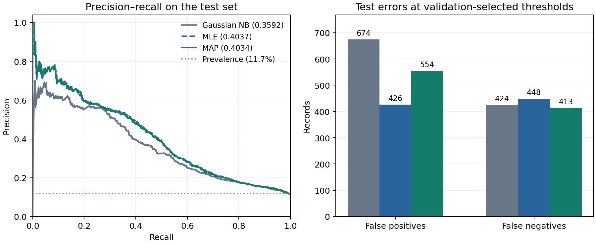

# Bank Marketing · 成员 B 实验结果

使用 UCI 原版 `bank-full.csv` 的 45,211 条记录，按 A 的种子 42 和固定行号划分，排除 `duration`。测试集有 6,781 条，其中 793 条认购。复跑高斯朴素贝叶斯得到与 A 已保存结果一致的排序指标和混淆矩阵。[A 的结果](../../bank-marketing-a/results_a/RESULTS.md)

## 先验强度与系数

在训练集内做分层 5 折，以平均梯形 PR-AUC 选出 **λ = 10**。MLE（λ = 0）的平均 PR-AUC 为 0.40617，MAP 为 0.40658，提升 0.00040。λ = 30 时为 0.40516，λ = 100 时降至 0.39669。[各折结果](cv_pr_auc.csv)

MAP 的系数 L2 范数（不含截距）从 **3.7713** 降至 **3.4540**，减少 8.4%。例如，`poutcome=success` 相对于 `failure` 的系数从 +2.267 降到 +2.093，`month=jan` 相对于 `apr` 的系数从 −1.191 变为 −1.005。联合拟合时个别系数的绝对值也可能增加。[系数表](coefficients.csv)

## 同一测试集比较

每个模型在独立验证集上选择 F1 最大的阈值。阈值列为 sigmoid 转换后的分数，决策时使用未四舍五入的 log-odds。混淆矩阵的行是真实 no、yes，列是预测 no、yes。

| 模型 | 阈值 | ROC-AUC | 梯形 PR-AUC | 准确率 | 精确率 | 召回率 | F1 | TN | FP | FN | TP |
| --- | ---: | ---: | ---: | ---: | ---: | ---: | ---: | ---: | ---: | ---: | ---: |
| A · 高斯 NB | 0.3846 | 0.7497 | 0.3592 | 0.8381 | 0.3538 | 0.4653 | 0.4020 | 5,314 | 674 | 424 | 369 |
| 逻辑回归 MLE | 0.1912 | 0.7638 | 0.4037 | 0.8711 | 0.4475 | 0.4351 | 0.4412 | 5,562 | 426 | 448 | 345 |
| 高斯先验 MAP | 0.1714 | 0.7641 | 0.4034 | 0.8574 | 0.4069 | 0.4792 | 0.4401 | 5,434 | 554 | 413 | 380 |

两种逻辑回归的测试 PR-AUC 都比 A 高约 0.044，彼此只差 0.00032。按各自验证集阈值，MAP 将 163 条 MLE 判为 no 的记录改判为 yes，其中 35 条实际认购，128 条未认购。与 MLE 相比，MAP 召回提高 4.41 个百分点，精确率下降 4.06 个百分点，F1 接近。共同使用 0.5 阈值时，MAP 从 MLE 的 65 条误报、670 条漏报变为 58 条误报、681 条漏报。因此上述召回差异取决于选择哪个阈值。[完整指标](metrics.json)

## 分组与错例

`contact=cellular` 组占 MAP 相对 MLE 新增误报的 123/128、挽回漏报的 33/35。这组也占测试集 4,411/6,781。组内误报率从 382/3,745（10.20%）升到 505/3,745（13.48%），漏报率从 354/666（53.15%）降到 321/666（48.20%）。在 `poutcome=success` 组，三个模型均将 193 条记录判为 yes，其中 73 条实际未认购。[各组分母与错例计数](error_groups.csv)

| 原始记录号 | 真实标签 | MLE 分数及预测 | MAP 分数及预测 | 记录特征 |
| ---: | --- | --- | --- | --- |
| 45133 | no | +2.136，误报 | +1.964，误报 | 上次营销成功，对两种模型分别贡献 +2.267、+2.093 |
| 17874 | yes | −5.214，漏报 | −5.205，漏报 | 本轮累计联系 29 次，`campaign` 分别贡献 −2.485、−2.491 |
| 42626 | no | −1.511，正确 | −1.289，误报 | 退休、1 月联系、上次营销失败。MAP 的分数与阈值均发生变化 |
| 40887 | yes | −1.629，漏报 | −1.502，正确 | 手机联系、8 月、上次营销失败。MAP 分数越过其验证集阈值 |

分数是 log-odds。MLE 和 MAP 的精确阈值分别约为 −1.442 和 −1.576。字段贡献是编码特征与系数的乘积，同一字段的独热列相加。这里用样本说明模型怎样打分。分组变化来自同一次随机切分，样本分组有重叠，未来时段的效果仍待验证。[全部测试错例](misclassified_test.csv)

## 修改记录

2026-11-22 用 UCI 原始完整数据运行三模型对照，记录交叉验证、系数变化、两种阈值口径及按 `source_record` 核对的错例。摘要及图表用于成员 C 的整合材料。
