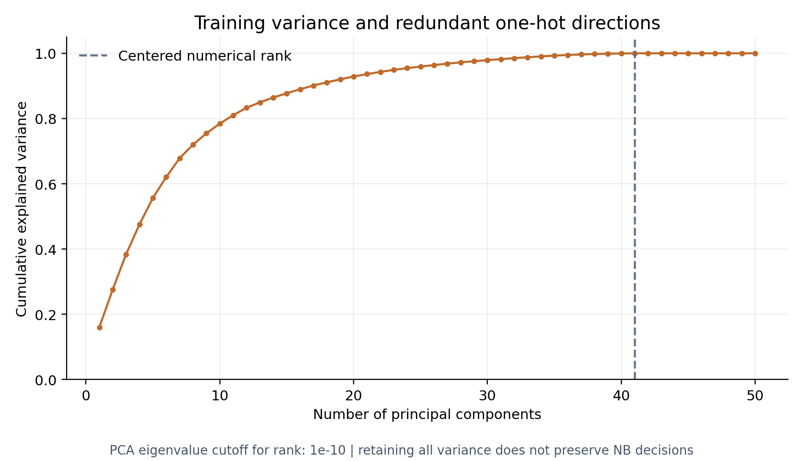
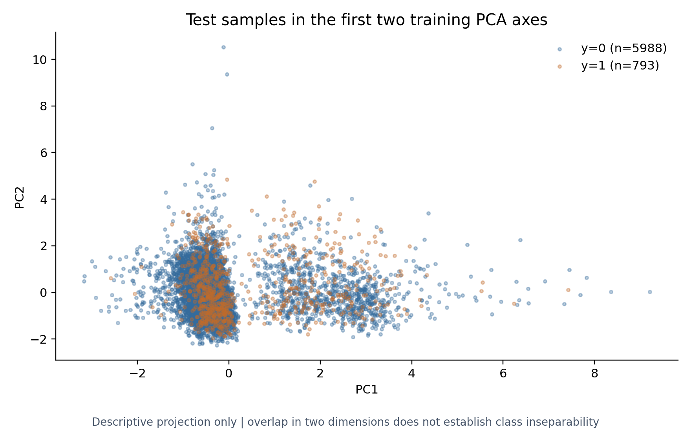

# PCA 与 SVD 实验结果

数据：bank-full.csv，排除 duration；训练/验证/测试分别为 31,648 / 6,782 / 6,781，测试正例 793。
预处理使用训练集拟合的标准化与完整独热编码，共 50 列。

## 实验设置与 k 选择

分类器为 A 手写 Gaussian NB，var_smoothing=0.01。PCA 中心化后分解协方差矩阵，SVD 对未中心化矩阵做经济型分解。
两种方法分别按验证集 pr_auc 选 k，数值差不超过 1e-12 时取较小 k。
候选值为 [1, 5, 10, 15, 20, 25, 30, 35, 40, 41, 42, 43, 45, 50]。每种表示再按验证集最大 F1 选阈值，并列取较高阈值，固定后评价测试集。
PR-AUC 为连续 log-odds 的梯形积分，AP 单独保存。

| 表示 | k | 验证 PR-AUC | 累计方差比例 | 验证阈值 |
| --- | --- | --- | --- | --- |
| PCA | 41 | 0.3387 | 1.0000 | -1.0663 |
| SVD | 42 | 0.3290 | 1.0000 | 0.2441 |

## 测试集主结果

各行使用自己的验证集阈值与所选维数。

| method | dimensions | pr_auc | roc_auc | precision | recall | f1 | fp | fn |
| --- | --- | --- | --- | --- | --- | --- | --- | --- |
| Original | 50 | 0.3592 | 0.7497 | 0.3538 | 0.4653 | 0.4020 | 674 | 424 |
| PCA | 41 | 0.3315 | 0.7337 | 0.3958 | 0.3758 | 0.3855 | 455 | 495 |
| SVD | 42 | 0.3220 | 0.7286 | 0.4261 | 0.3380 | 0.3769 | 361 | 525 |

固定相同 k=41 的比较见 fixed_k_comparison.csv。

## 默认阈值辅助结果

以下统一使用 log-odds >= 0。排序指标与阈值无关。

| method | dimensions | pr_auc | roc_auc | precision | recall | f1 | fp | fn |
| --- | --- | --- | --- | --- | --- | --- | --- | --- |
| Original | 50 | 0.3592 | 0.7497 | 0.3698 | 0.4477 | 0.4050 | 605 | 438 |
| PCA | 41 | 0.3315 | 0.7337 | 0.4228 | 0.3417 | 0.3780 | 370 | 522 |
| SVD | 42 | 0.3220 | 0.7286 | 0.4176 | 0.3417 | 0.3759 | 378 | 522 |

## 小组测试结果

| method | dimensions | pr_auc | roc_auc | precision | recall | f1 | fp | fn |
| --- | --- | --- | --- | --- | --- | --- | --- | --- |
| Gaussian NB | 50 | 0.3592 | 0.7497 | 0.3538 | 0.4653 | 0.4020 | 674 | 424 |
| MLE | 41 | 0.4037 | 0.7638 | 0.4475 | 0.4351 | 0.4412 | 426 | 448 |
| MAP | 41 | 0.4034 | 0.7641 | 0.4069 | 0.4792 | 0.4401 | 554 | 413 |
| PCA + NB | 41 | 0.3315 | 0.7337 | 0.3958 | 0.3758 | 0.3855 | 455 | 495 |
| SVD + NB | 42 | 0.3220 | 0.7286 | 0.4261 | 0.3380 | 0.3769 | 361 | 525 |

全部使用各自验证集所选阈值。MLE/MAP 引用 B 经来源核对的保存结果，采用参考编码 41 列；C 的 NB 降维实验采用完整编码。

## 控制实验与误分类

中心化后的有效维数为 41，未中心化矩阵的数值秩为 42。
验证集平滑量控制见 smoothing_ablation_validation.csv，类内协方差统计见 coordinate_diagnostics_train.csv，重构误差见 metrics.json。
Gaussian NB 的对角方差假设依赖坐标系，完整方差保留与分类性能应分别评价。

misclassified_samples.csv 保存主阈值下的全部 FP/FN，source_record 为原始 CSV 从 1 开始、不含表头的记录号。
misclassification_summary.csv 和 misclassification_feature_summary.csv 提供计数及特征统计。
qualitative_cases.csv 按记录号选取各类预测转变的案例。完整分数与两套预测可通过返回值 tables['test_predictions'] 获取。

运行命令见 [README](../README.md)，完整指标见 metrics.json。本轮结果基于同一次数据划分。

## 图表

其他图表见 test_pr_curves.png、smoothing_ablation.png。
