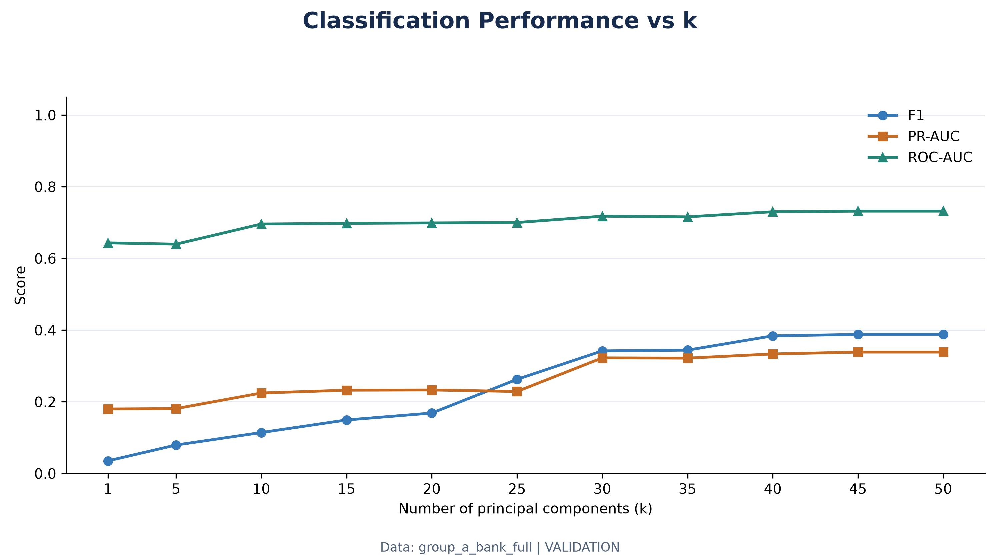
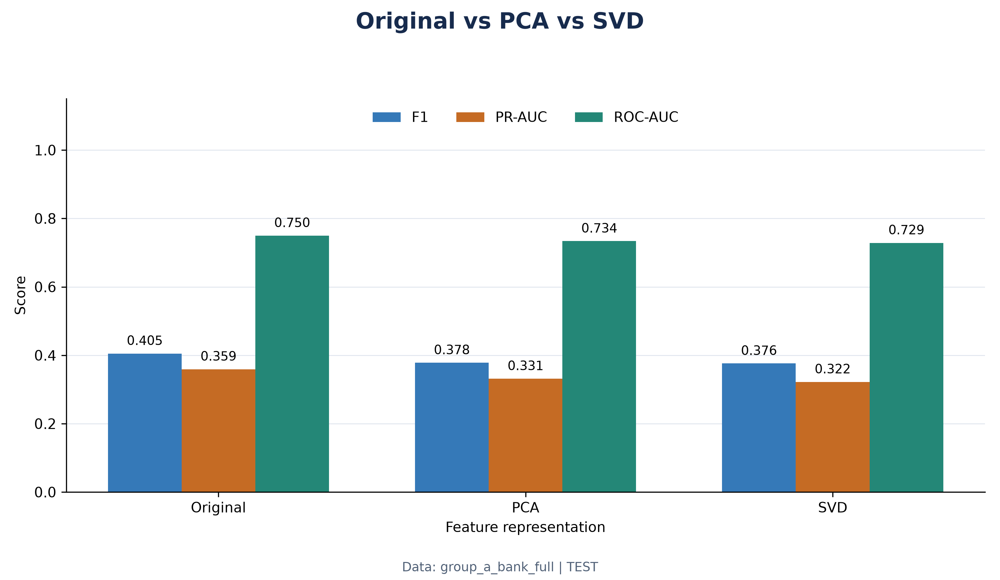
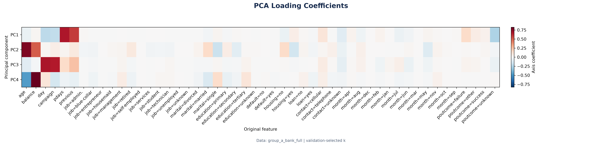

# PCA 与 SVD 实验结果

数据为原版 bank-full.csv，共 45,211 条。训练集 31,648 条、验证集 6,782 条、测试集 6,781 条；编码后 50 列，不含 duration。

分类器为 GaussianNB，var_smoothing=0.01，分类阈值为 log-odds ≥ 0。ROC-AUC 和梯形 PR-AUC 使用连续 log-odds。

## 验证集选择

候选 k 为 [1,5,10,15,20,25,30,35,40,45,50]。验证集 PR-AUC 在 45、50 时均为 0.3387，按并列取较小值的规则选择 k=45。

## 测试集指标

| 表示 | 维数 | Accuracy | Precision | Recall | F1 | PR-AUC | ROC-AUC |
| --- | ---: | ---: | ---: | ---: | ---: | ---: | ---: |
| Original | 50 | 0.8462 | 0.3698 | 0.4477 | 0.4050 | 0.3592 | 0.7497 |
| PCA | 45 | 0.8685 | 0.4228 | 0.3417 | 0.3780 | 0.3315 | 0.7337 |
| SVD | 45 | 0.8673 | 0.4176 | 0.3417 | 0.3759 | 0.3220 | 0.7286 |

## 误分类

| 表示 | FP | FN |
| --- | ---: | ---: |
| Original | 605 | 438 |
| PCA | 370 | 522 |
| SVD | 378 | 522 |

完整记录见 misclassified_samples.csv。source_record 为原始 CSV 的记录号，从 1 开始，不含表头。特征统计见 misclassification_feature_summary.csv，使用预处理后的特征尺度。

## PCA 可视化

数值指标与实验配置见 metrics.json；k 扫描见 validation_k_results.csv；样本划分见 split_indices.csv。