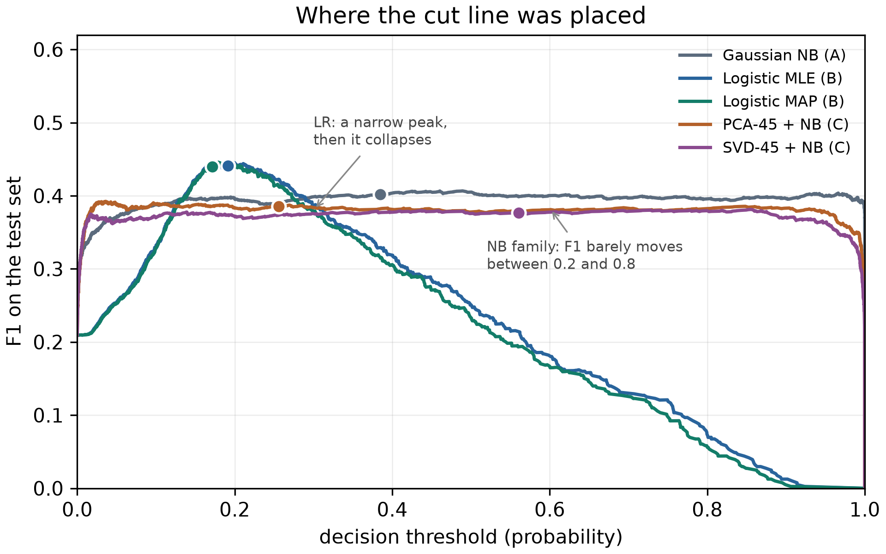
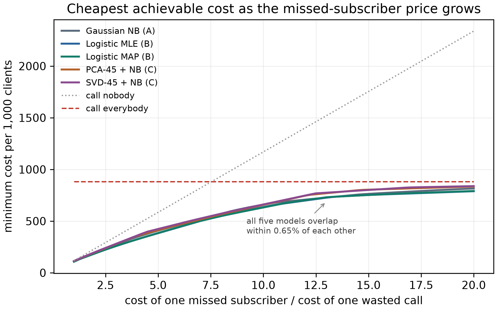
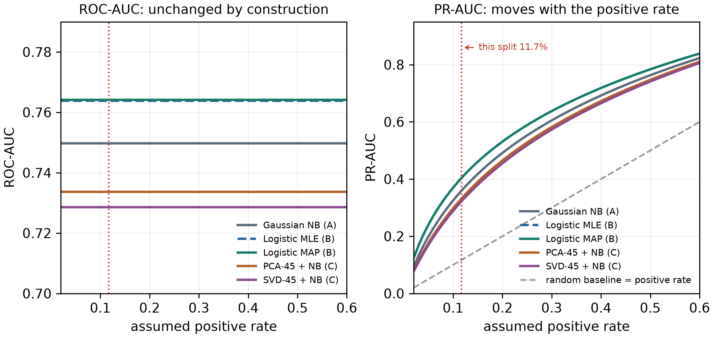

# 类别不平衡敏感性：成员 D 实验结果

数据为 UCI `bank-full.csv` 共 45,211 条，沿用 A 的种子 42 分层划分与 `../bank-marketing-a/results_a/split_indices.csv`，排除 `duration`。测试集 6,781 条，其中 793 条认购（11.69%）。五个模型全部由 A/B/C 的模块重新拟合，参数取 A 的 `var_smoothing=0.01`、B 的 λ=10、C 的 k=45。阈值统一取验证集上 F1 最大的那一个；PR-AUC 为梯形积分。

## 复现校验

五个模型的分数经本模块重算后与 A/B/C 的报告值逐项比对，误差均在 5×10⁻⁷ 以内，属于浮点噪声。

| 模型 | ROC-AUC（报告 / 重算） | PR-AUC（报告 / 重算） | 验证集阈值 | 判为会买 | TP / FP / FN |
| --- | --- | --- | ---: | ---: | --- |
| gnb（A） | 0.7497 / 0.749715 | 0.3592 / 0.359247 | 0.3846 | 1,043 | 369 / 674 / 424 |
| lr_mle（B） | 0.7638 / 0.763849 | 0.4037 / 0.403700 | 0.1912 | 771 | 345 / 426 / 448 |
| lr_map（B） | 0.7641 / 0.764123 | 0.4034 / 0.403385 | 0.1714 | 934 | 380 / 554 / 413 |
| pca_gnb（C） | 0.7337 / 0.733655 | 0.3315 / 0.331495 | 0.2561 | 753 | 298 / 455 / 495 |
| svd_gnb（C） | 0.7286 / 0.728579 | 0.3220 / 0.321959 | 0.5607 | 629 | 268 / 361 / 525 |

PCA/SVD 两行的 F1 与 C 的 `RESULTS.md` 不同（C 为 0.3780/0.3759），原因是 C 使用固定阈值 `log-odds ≥ 0`，本表改用验证集阈值；排序指标一致。

## S1：操作点与代价敏感性

### 阈值敏感度两极分化

同一批分数，只改阈值：

| 模型 | F1 @ 0.2 | F1 @ 0.5 | F1 @ 0.8 |
| --- | ---: | ---: | ---: |
| gnb | 0.3955 | 0.4050 | 0.3959 |
| lr_mle | **0.4442** | 0.2508 | 0.0719 |
| lr_map | 0.4390 | 0.2326 | 0.0559 |
| pca_gnb | 0.3830 | 0.3780 | 0.3827 |
| svd_gnb | 0.3721 | 0.3759 | 0.3783 |

**逻辑回归在 0.17–0.20 有窄峰，离开后迅速塌陷；NB 家族在 0.2–0.8 之间几乎不变。** 该平台不是采样造成的：0.2–0.9 区间内有 519 条记录、分数互不相同，F1 仍只变化 ±0.01。

因此"高斯 NB 的最佳阈值 0.3846"缺乏意义——平台上的任一阈值效果相同；而逻辑回归的优势依赖一条窄区间，**好但脆弱**。

### 代价曲线：五个模型几乎重合

总代价定义为 `FP + r·FN`，`r` 为漏报代价与误报代价之比，每 1,000 名客户计。

| r | gnb | lr_mle | lr_map | pca_gnb | svd_gnb | 冠亚军差距 |
| ---: | ---: | ---: | ---: | ---: | ---: | ---: |
| 1 | 110.0 | 107.4 | 107.2 | 113.0 | 114.1 | 0.14% |
| 5 | 408.3 | 383.0 | 384.8 | 412.3 | 423.8 | 0.46% |
| 10 | 659.3 | 635.9 | 631.8 | 657.0 | 661.1 | 0.65% |
| 20 | 815.4 | 789.1 | 791.0 | 835.0 | 838.5 | 0.24% |

**差距始终在 0.1%–0.65% 之间，远小于模型内部的阈值选择余地。**

不预设代价比时，冠军在 lr_mle 与 lr_map 之间反复交替（r=1 为 lr_map，1.25–3.50 为 lr_mle，3.75–4.00 为 lr_map，……），每次交替的差距都在上述噪声量级。若把阈值固定在团队现有取值，则只有一次翻转：r ≤ 3.50 时 lr_mle 最省，r ≥ 3.75 时 lr_map 最省。

### 真正的变量是阈值，不是模型

团队提交的冠军是 lr_mle（F1 0.4412）。按它自己的验证集阈值固定后：

| 代价比 r | 最优成本 | 团队方案成本 | 超额支出 | 模型比"全不打"好 |
| ---: | ---: | ---: | ---: | ---: |
| 1 | 107.2 | 128.9 | **+20.2%** | 8.3% |
| 5 | 383.0 | 393.2 | +2.7% | 34.5% |
| 10 | 631.8 | 723.5 | **+14.5%** | 46.0% |
| 15 | 752.2 | 1053.8 | **+40.1%** | 57.1% |
| 20 | 789.1 | 1384.2 | **+75.4%** | 66.3% |

**换模型最多带来 0.65% 的改善，换阈值最多带来 75% 的改善。**

另外两点：`r=1` 时最优模型只比"一个电话都不打"好 **8.3%**，因为全判负已有 88.31% 准确率；模型的价值随漏报代价上升才显现。"全打"的代价恒为 883.1，在所有 `r` 下都劣于最优模型。

## S3：正类先验漂移敏感性

给测试集加权（正类 `π′/π`，负类 `(1−π′)/(1−π)`），在 2%–60% 共 60 个档位重算。**不增删、不重标任何记录。**

| 模型 | 5% | **11.7%（本数据）** | 20% | 30% | 50% |
| --- | ---: | ---: | ---: | ---: | ---: |
| gnb PR-AUC | 0.1991 | 0.3592 | 0.4913 | 0.6050 | 0.7631 |
| lr_mle PR-AUC | 0.2408 | 0.4037 | 0.5308 | 0.6376 | 0.7837 |
| lr_map PR-AUC | 0.2404 | 0.4034 | 0.5307 | 0.6375 | 0.7838 |
| pca_gnb PR-AUC | 0.1764 | 0.3315 | 0.4647 | 0.5819 | 0.7471 |
| svd_gnb PR-AUC | 0.1696 | 0.3220 | 0.4548 | 0.5729 | 0.7410 |
| gnb ROC-AUC | 0.7497 | 0.7497 | 0.7497 | 0.7497 | 0.7497 |
| lr_mle ROC-AUC | 0.7638 | 0.7638 | 0.7638 | 0.7638 | 0.7638 |

**ROC-AUC 在全部 60 个档位上的极差为 6.4×10⁻¹⁴**——数学上恒等，因为两条轴都是类内比例。**PR-AUC 却从 0.24 摆到 0.78。**

换成相对随机基线（PR-AUC / 正类比例）后：

| 模型 | 5% | 11.7% | 20% | 30% | 50% |
| --- | ---: | ---: | ---: | ---: | ---: |
| lr_mle | **4.82×** | **3.45×** | 2.65× | 2.13× | **1.57×** |
| gnb | 3.98× | 3.07× | 2.46× | 2.02× | 1.53× |

**模型的相对价值在稀有事件场景最大。** 若一半客户都会认购，最优模型只比随机排序好 57%，几乎失去意义；正因本数据只有 11.69% 会认购，排序才产生价值。

**模型排名在 60 个档位中一次未变**（lr_mle ≈ lr_map > gnb > pca_gnb > svd_gnb）。这一点与 S1 互补：S1 说明相邻模型的差距小到不足为凭，S3 说明"谁属于第一梯队"是稳定的。

### 阈值随先验如何调整

若已知目标名单的正类比例，逻辑回归的 F1 最优阈值单调移动，可直接用于部署：

| 正类比例 | 5% | 11.7% | 20% | 30% | 50% |
| --- | ---: | ---: | ---: | ---: | ---: |
| lr_mle 阈值（概率） | 0.2442 | 0.1976 | 0.1637 | 0.1263 | 0.0546 |
| lr_mle 阈值（log-odds） | −1.130 | −1.401 | −1.631 | −1.934 | −2.852 |

**高斯 NB 无法给出可用的对照表**：同样的计算下阈值为 1.0000 / 0.4893 / 0.1313 / 0.1313 / 0.0003，跳跃无规律。这是上文"平台"的直接后果——F1 曲线太平，最高点的位置近乎任意。

> 表中 11.7% 一行的 0.1976 是在**测试集**上按加权 F1 求得的，与团队在**验证集**上选出的 0.1912 属于不同数据，不构成矛盾。

## 结论

1. 五个模型在这批数据上**不存在有意义的优劣**，代价差 0.1%–0.65%：模型选择不是本题的关键变量。
2. **阈值选择的影响比模型选择大两个数量级**：团队沿用的"验证集 F1 最优阈值"在 20:1 的代价比下多花 75%，在 1:1 下多花 20%。报告应同时给出代价最优阈值。
3. **PR-AUC 的数值依赖于正类比例**，0.4037 只对应 11.69% 的场景；跨场景比较应使用相对基线倍数（4.82× → 1.57×）。
4. **高斯 NB 的阈值不可部署**：F1–阈值曲线平坦，最优阈值不稳定，也无法随先验变化给出单调的调整规则。

## 局限

代价比 `r` 与"全打/全不打"都是示意性设定，未使用银行的真实成本数据；`r` 超过 20 后最优策略会趋向"全打"，本实验未覆盖。S3 的加权只在测试集上进行，未重新训练模型，因此衡量的是**同一模型的指标随先验的变化**，而非"在新先验下重新训练能得到什么"。所有结论建立在一次随机分层切分上，未验证未来时段的表现。

数据来源：[UCI Bank Marketing](https://archive.ics.uci.edu/dataset/222/bank+marketing)。
